# Manual de Usuario — CinemaUSAC (Fase 3)

**Curso:** Estructuras de Datos — Universidad de San Carlos de Guatemala
**Aplicación:** CinemaUSAC, sistema de cartelera, funciones, reservas y ventas con grafo de sedes, blockchain y persistencia comprimida.

> Las imágenes de este manual están en la carpeta `documentacion/capturas/`. Cada imagen tiene el nombre que se indica entre paréntesis.

---

## Índice
1. [Introducción](#1-introducción)
2. [Requisitos e instalación](#2-requisitos-e-instalación)
3. [Inicio de la aplicación](#3-inicio-de-la-aplicación)
4. [Inicio de sesión](#4-inicio-de-sesión)
5. [Módulo de administrador](#5-módulo-de-administrador)
6. [Módulo de cliente](#6-módulo-de-cliente)
7. [Formatos de los archivos de carga masiva](#7-formatos-de-los-archivos-de-carga-masiva)
8. [Archivos que genera el programa](#8-archivos-que-genera-el-programa)
9. [Cómo empezar desde cero](#9-cómo-empezar-desde-cero)
10. [Mensajes y errores frecuentes](#10-mensajes-y-errores-frecuentes)

---

## 1. Introducción

CinemaUSAC permite administrar una cadena de cines. En esta fase se agregaron tres elementos principales:

- **Grafo de sedes:** cada sede es un vértice. Dos sedes se conectan cuando proyectan películas en común; el peso de la conexión es la cantidad de películas distintas que comparten.
- **Blockchain de ventas:** cada compra de boleto se registra como una transacción dentro de bloques encadenados con hash SHA-256. Si alguien modifica un bloque, el programa lo detecta al iniciar.
- **Persistencia comprimida:** las sedes, películas y funciones se guardan al cerrar el programa en archivos `.edd` comprimidos con el algoritmo LZW, y se restauran al abrirlo.

La aplicación tiene dos tipos de usuario: **administrador** y **cliente**.

## 2. Requisitos e instalación

| Requisito | Detalle |
|---|---|
| Sistema operativo | Windows 10/11 |
| Entorno | Qt Creator con Qt 6.11 (kit MinGW 64-bit) |
| Graphviz | Instalado y agregado al PATH (necesario para los reportes) |

**Pasos para ejecutar**
1. Abrir Qt Creator y elegir **File → Open File or Project...**.
2. Seleccionar el archivo `CinemaUSAC.pro` de la carpeta `EDD_Fase3`.
3. En la pantalla *Configure Project* dejar marcado el kit **Desktop Qt 6.11 MinGW 64-bit** y pulsar **Configure Project**.
4. Compilar con **Ctrl+B** y ejecutar con **Ctrl+R**.

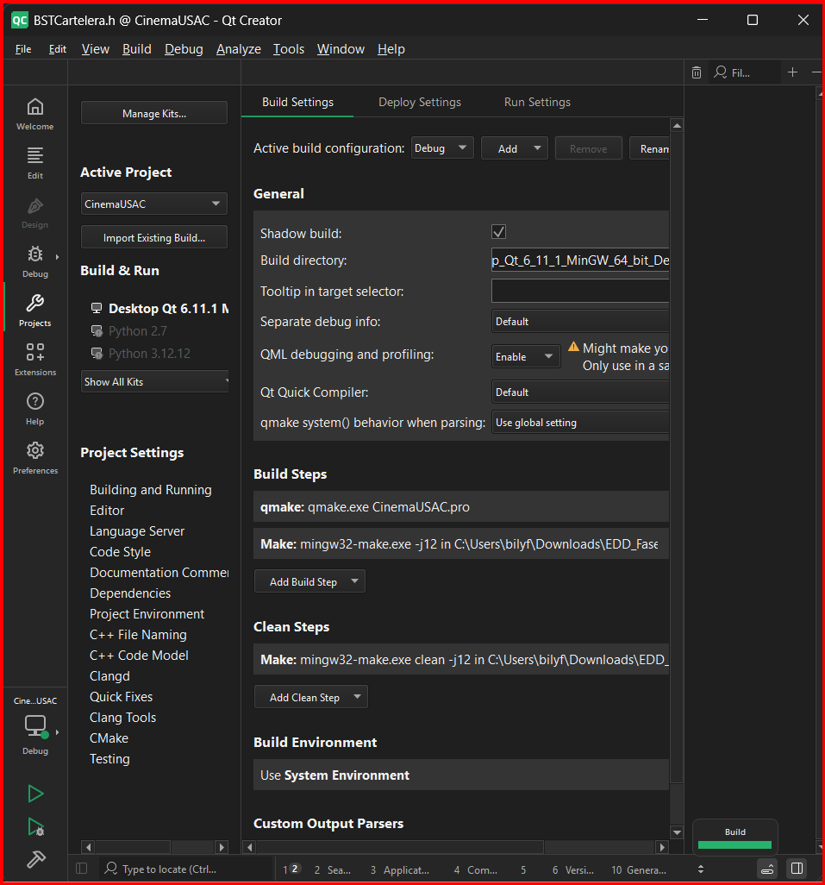
*(01_configurar_proyecto.png)*

**Verificar Graphviz:** abrir `cmd` y escribir `dot -V`. Debe mostrar la versión instalada. Si no la muestra, instalar Graphviz marcando la opción *Add Graphviz to the system PATH* y reiniciar Qt Creator.

## 3. Inicio de la aplicación

Al abrir el programa ocurre lo siguiente, de forma automática:

1. Se leen `sedes.edd`, `peliculas.edd` y `funciones.edd` (si existen), se descomprimen y se reconstruyen el grafo, la cartelera y las funciones.
2. Se leen los bloques de la carpeta `blocks` y se verifica la integridad de cada uno.
3. Se reconstruye la Tabla Hash de reservas usando solo las transacciones de los bloques íntegros.
4. Si algún bloque fue manipulado, aparece un aviso (ver sección 5.5).

Los **clientes no se guardan** entre ejecuciones: hay que volver a cargar el archivo de clientes cada vez que se abre el programa.

## 4. Inicio de sesión

La primera pantalla es el panel de login.

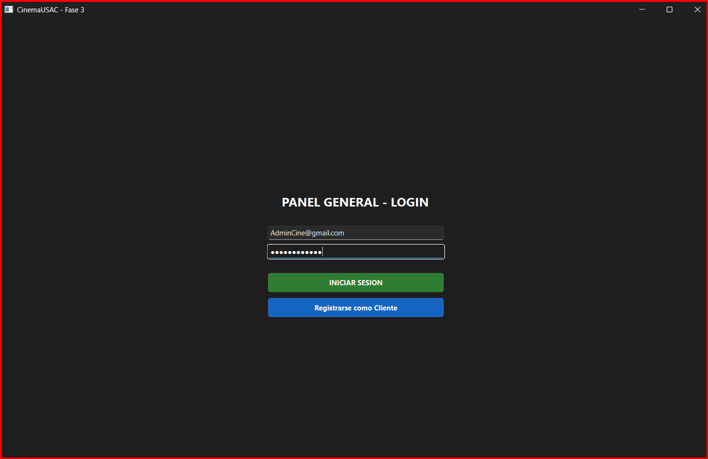
*(02_login.png)*

| Tipo | Correo | Contraseña |
|---|---|---|
| Administrador | `AdminCine@gmail.com` | `admin123Pass` |
| Cliente | el correo de un cliente cargado (ejemplo: `ana@correo.com`) | su contraseña (ejemplo: `1234`) |

También se puede crear una cuenta con el botón **Registrarse como Cliente**.

---

## 5. Módulo de administrador

El panel administrativo tiene las pestañas: **Cartelera, Sedes (Grafo), Funciones y Asientos, Clientes, Blockchain, Carga Masiva JSON, Promociones, Solicitudes Especiales** y **Reportes Visuales**. Arriba a la derecha están los botones **Generar Reportes Graphviz** y **Cerrar Sesión**.

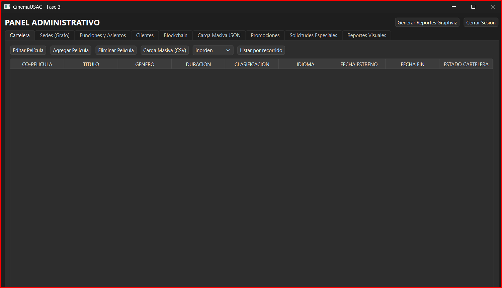
*(03_panel_admin.png)*

### 5.1 Carga masiva (pestaña "Carga Masiva JSON")

1. Pulsar el botón de películas y elegir el archivo JSON con `sedes`, `peliculas` y `funciones`.
2. Al terminar aparece un resumen con las sedes, películas y funciones cargadas, las funciones rechazadas y el detalle de cada error.
3. Pulsar el botón de clientes y elegir el JSON de clientes (incluye reservas opcionales).

**Reglas de validación**
- Una función se **rechaza** si su `sede` no existe, si su código está repetido o si la fecha es inválida.
- Una película con fechas inválidas o campos obligatorios vacíos se omite.
- Una sede o un cliente con código/correo repetido se omite.
- Una reserva con código repetido se omite.

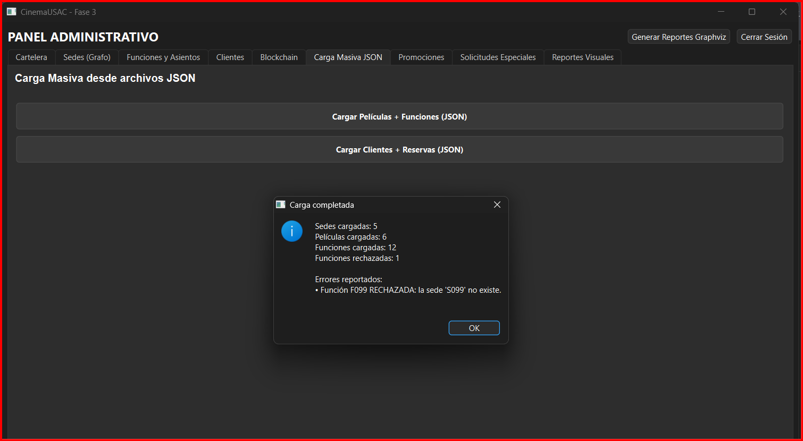
*(04_carga_masiva.png)*

Los archivos de ejemplo están en la carpeta `ejemplos/`.

### 5.2 Gestión de sedes (pestaña "Sedes (Grafo)")

La tabla muestra código, nombre, dirección, salas, teléfono, cantidad de funciones y cantidad de conexiones de cada sede. Las conexiones (aristas) **se crean solas**: no se agregan a mano. Cambian cada vez que se crea, edita o elimina una función.

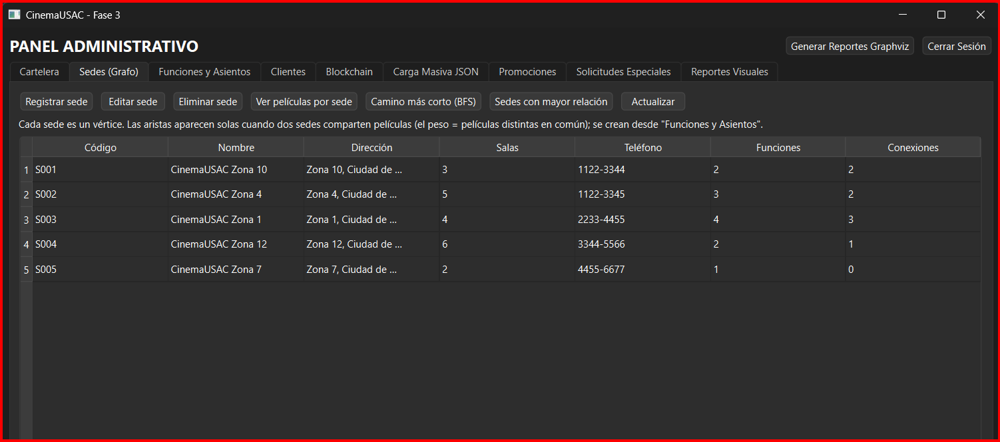
*(05_sedes.png)*

| Botón | Qué hace |
|---|---|
| **Registrar sede** | Pide código, nombre, dirección, cantidad de salas y teléfono. Rechaza códigos repetidos. |
| **Editar sede** | Elige una sede y permite cambiar nombre, dirección, salas y teléfono. |
| **Eliminar sede** | Elimina el vértice, sus conexiones **y las funciones de esa sede**, previa confirmación. |
| **Ver películas por sede** | Muestra las películas que se proyectan en la sede elegida. |
| **Camino más corto (BFS)** | Pide origen y destino y muestra el camino con menos saltos entre las dos sedes. Si no hay camino lo indica. |
| **Sedes con mayor relación** | Muestra las parejas de sedes ordenadas de mayor a menor cantidad de películas compartidas. |
| **Actualizar** | Refresca la tabla. |

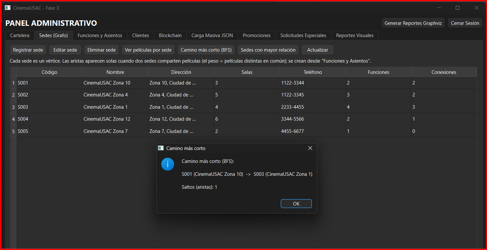
*(06_camino_bfs.png)*

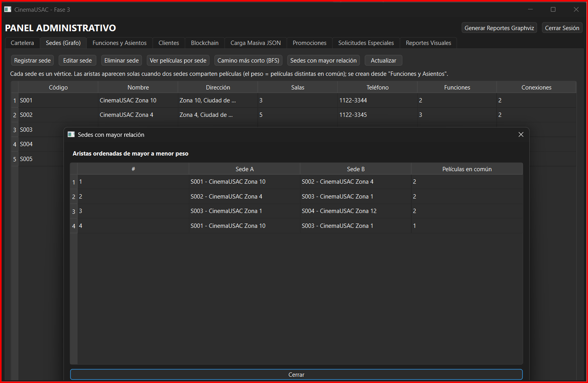
*(07_ranking_sedes.png)*

### 5.3 Cartelera y funciones

- **Cartelera:** permite agregar, editar y eliminar películas, cargar un CSV y listar el árbol por recorrido inorden, preorden o postorden. Las películas a las que les faltan 7 días o menos para terminar aparecen en **amarillo** con el estado "Próximo a retirar".
- **Funciones y Asientos:** permite crear, editar y eliminar funciones. Ahora cada función se asocia a una **sede**; si la sede no existe, la operación se rechaza. Al cambiar una función, las conexiones del grafo se recalculan.

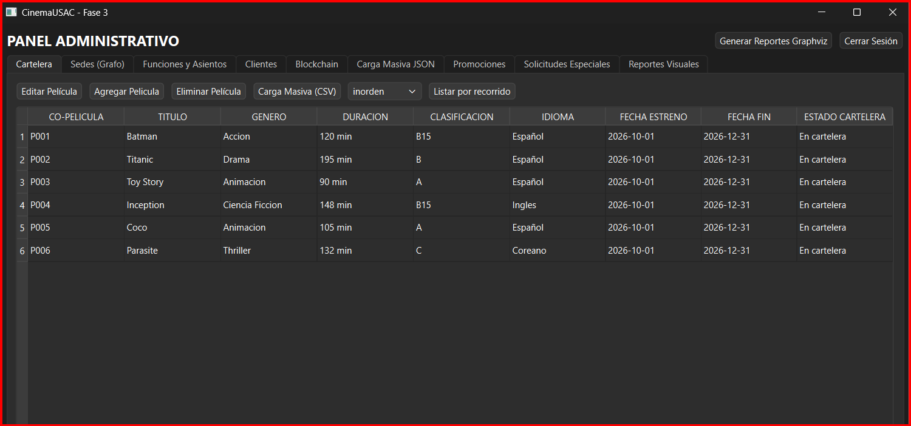
*(08_cartelera.png)*

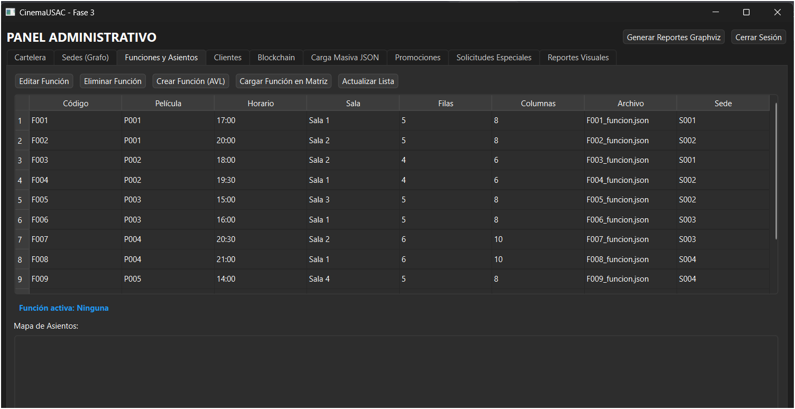
*(09_funciones.png)*

### 5.4 Blockchain (pestaña "Blockchain")

Muestra una fila por bloque con INDEX, TIMESTAMP, NONCE, cantidad de transacciones, HASH, PREVIOUSHASH y estado. **Verde** significa bloque íntegro y **rojo** significa bloque manipulado. Arriba se muestra el total de bloques, los manipulados y las transacciones pendientes.

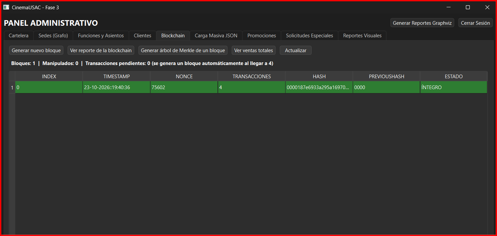
*(10_blockchain.png)*

| Botón | Qué hace |
|---|---|
| **Generar nuevo bloque** | Crea un bloque con todas las transacciones pendientes. Si no hay pendientes lo avisa. |
| **Ver reporte de la blockchain** | Muestra la cadena de bloques como imagen (verde/rojo). |
| **Generar árbol de Merkle de un bloque** | Pide el índice de un bloque y dibuja su árbol de Merkle. |
| **Ver ventas totales** | Muestra boletos vendidos y monto total, con desglose por función y por fecha. Las compras canceladas se restan. |
| **Actualizar** | Refresca la tabla. |

**Cuándo se genera un bloque:**
1. Automáticamente, cada vez que se juntan **4** transacciones pendientes.
2. Manualmente, con el botón **Generar nuevo bloque**.
3. Al cerrar el programa, si quedan transacciones pendientes.

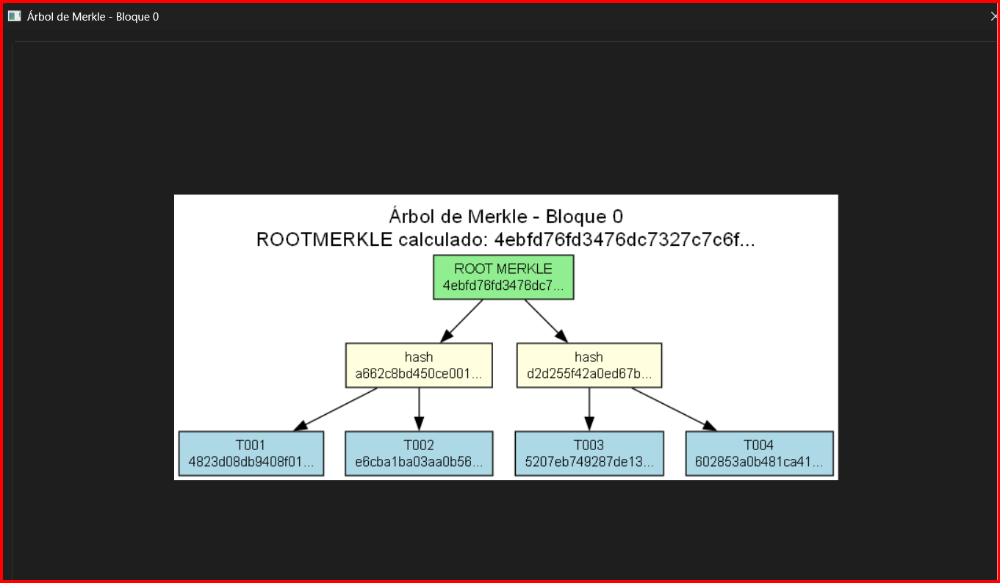
*(11_arbol_merkle.png)*

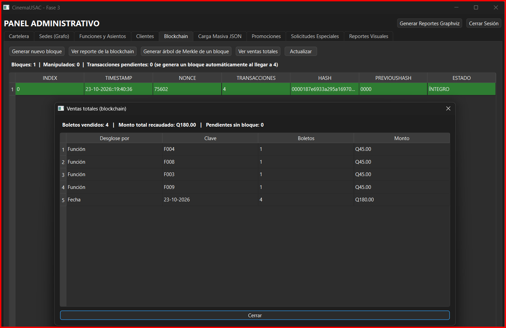
*(12_ventas_totales.png)*

### 5.5 Detección de bloques manipulados

Si un archivo de `blocks/` fue modificado, al abrir el programa aparece un aviso que indica qué bloque falló y por qué (por ejemplo, "ROOTMERKLE no coincide con las transacciones"). Reglas:

- Un bloque manipulado se marca en **rojo**.
- Todo lo que está **después** de un bloque manipulado también se descarta (se marca en rojo).
- Solo los bloques íntegros se usan para reconstruir las reservas, el historial y las ventas.
- Si se genera un bloque nuevo, la cadena continúa desde el último bloque íntegro y los bloques descartados se eliminan de la carpeta.

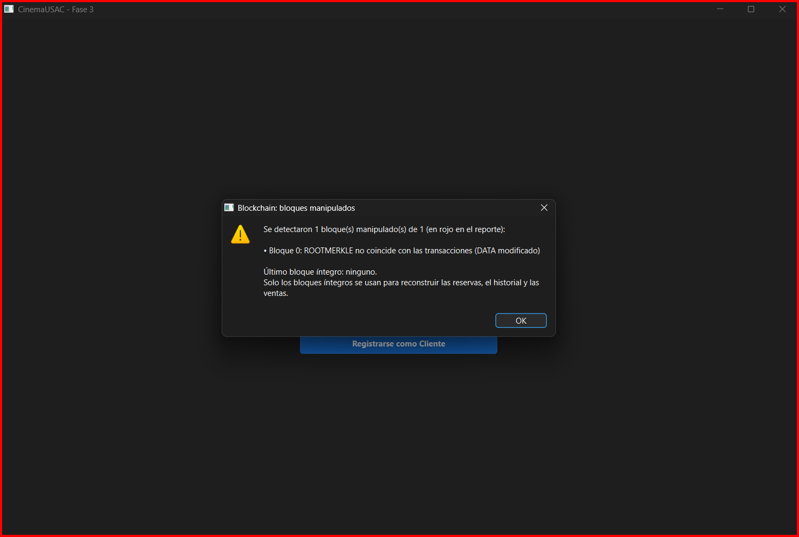
*(13_aviso_manipulado.png)*

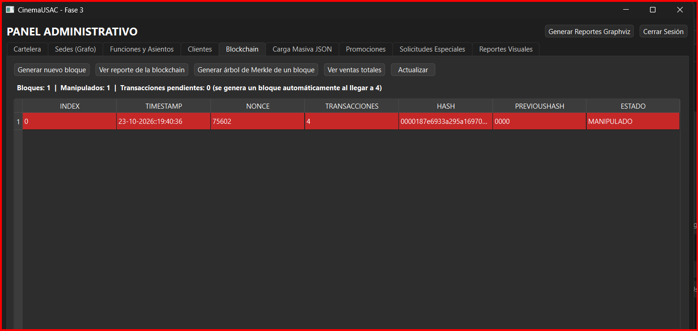
*(14_bloque_rojo.png)*

### 5.6 Reportes (pestaña "Reportes Visuales")

Primero se pulsa **Generar Reportes Graphviz** (arriba a la derecha) para crear todas las imágenes con los datos actuales. Luego, en la pestaña, cada botón muestra un reporte dentro de la aplicación:

| Botón | Reporte |
|---|---|
| 1. BST Películas | Árbol binario de búsqueda de la cartelera |
| 2. AVL Funciones | Árbol AVL de funciones (incluye la sede) |
| 3. Árbol B Clientes | Árbol B de clientes |
| 4. Tabla Hash | Tabla hash de reservas |
| 5. Matriz Asientos | Matriz dispersa de asientos de la función activa |
| 6. Grafo de Sedes | Grafo no dirigido ponderado de sedes |
| 7. Lista de Adyacencia | Lista de adyacencia del grafo |
| 8. Blockchain | Cadena de bloques (verde/rojo) |
| 9. Árbol de Merkle | Árbol de Merkle del último bloque |

Las imágenes se guardan en la carpeta `reportes/` junto al ejecutable.


*(15_reporte_grafo.png)*

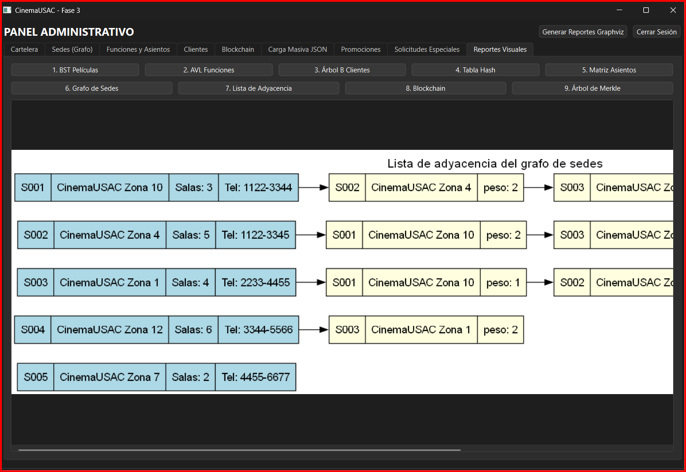
*(16_reporte_lista_adyacencia.png)*


*(17_reporte_blockchain.png)*

---

## 6. Módulo de cliente

El panel de cliente tiene las pestañas: **Ver Cartelera, Sedes (Grafo), Reservar / Cancelar, Mis Compras (Blockchain), Promociones, Solicitudes** y **Mi Perfil**.

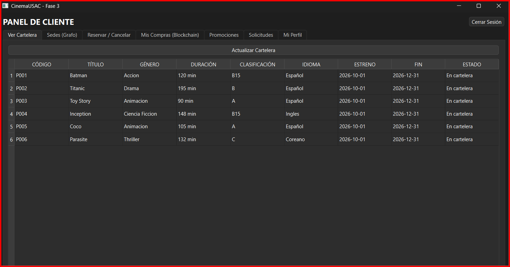
*(18_panel_cliente.png)*

### 6.1 Sedes (Grafo)

1. Elegir una **película** en el selector.
2. **Ver sedes donde está disponible:** lista las sedes y funciones de esa película.
3. Elegir una **sede** y pulsar **Ver funciones de la película en esta sede**.
4. **Ver sedes similares:** muestra las sedes más relacionadas con la elegida (las que comparten más películas).
5. **Actualizar lista** recarga las películas si el administrador cargó datos nuevos.

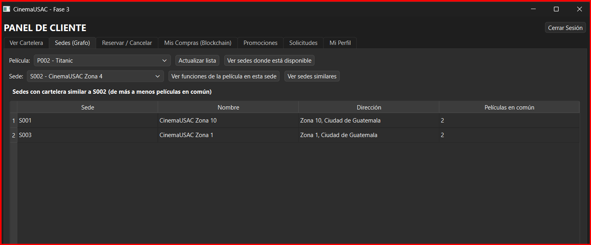
*(19_cliente_sedes.png)*

### 6.2 Reservar y comprar un boleto

1. En **Reservar / Cancelar**, elegir la **película**, luego la **sede** y luego la **función**.
2. Pulsar **Cargar mapa de asientos**. Verde = libre, rojo = ocupado.
3. Escribir la **fila** y la **columna** del asiento y pulsar **Reservar Asiento**.
4. Elegir el **método de pago** (Tarjeta o Efectivo). El precio es fijo: **Q45.00** por boleto.
5. Aparece un mensaje con la reserva y la transacción. Si ya había 4 pendientes, se indica el bloque generado.

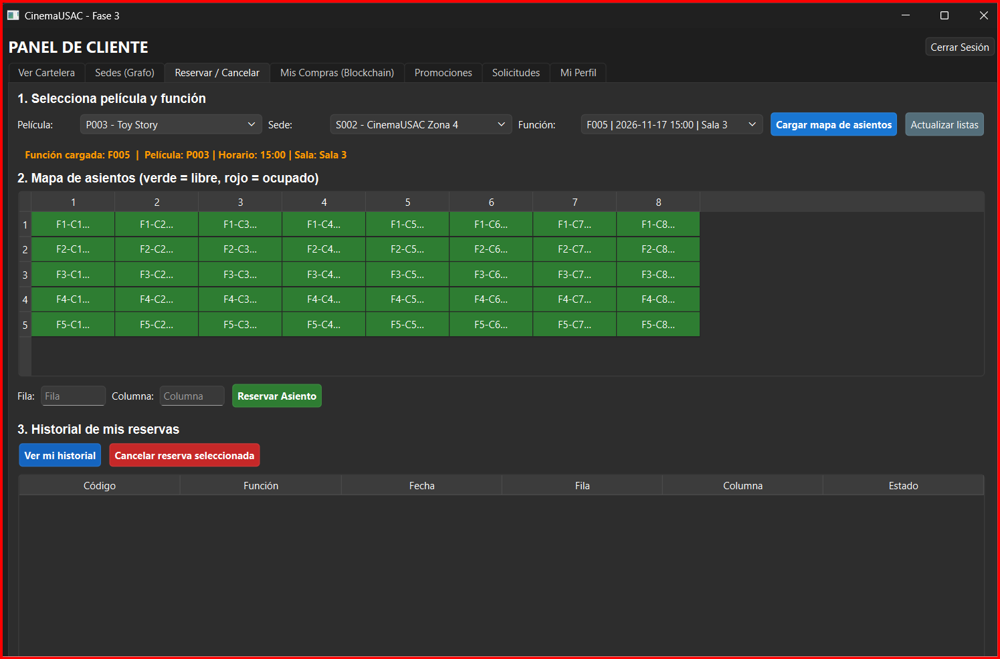
*(20_reservar.png)*

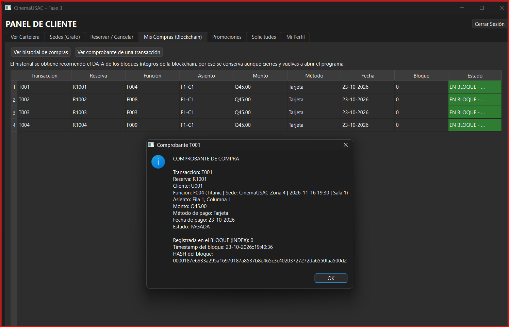
*(21_compra_ok.png)*

### 6.3 Cancelar una reserva

1. En la misma pestaña, pulsar **Ver mi historial** y seleccionar la reserva en la tabla.
2. Pulsar **Cancelar reserva seleccionada**. El asiento queda libre.
3. Si la compra todavía **no estaba en un bloque**, simplemente se retira de la cola de pendientes.
4. Si la compra **ya estaba en un bloque**, el bloque no se modifica: la misma transacción se registra de nuevo con estado **CANCELADA** en un bloque posterior. La escritura más reciente actualiza a la anterior.

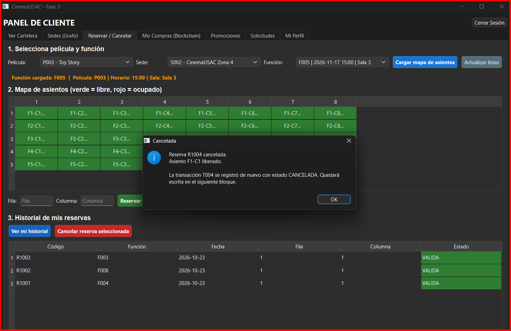
*(22_cancelar.png)*

### 6.4 Mis compras (blockchain)

- **Ver historial de compras:** muestra transacción, reserva, función, asiento, monto, método, fecha, bloque y estado (`PAGADA` o `CANCELADA`, en bloque o pendiente).
- **Ver comprobante de una transacción:** pide el código (ejemplo `T001`) y muestra el detalle, el bloque donde quedó registrada, su timestamp y su hash.

El historial se obtiene de la blockchain, por eso se conserva al cerrar y volver a abrir el programa.

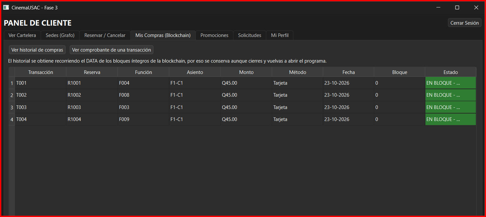
*(23_mis_compras.png)*

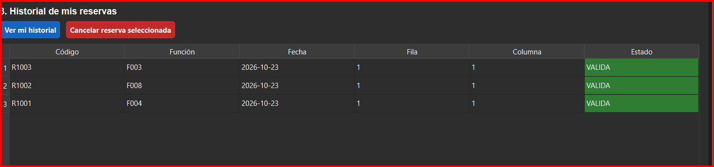
*(24_comprobante.png)*

---

## 7. Formatos de los archivos de carga masiva

**Películas, sedes y funciones**
```json
{
  "sedes": [
    { "codigo": "S001", "nombre": "CinemaUSAC Zona 10", "direccion": "Zona 10, Ciudad de Guatemala",
      "cantidad_salas": 3, "telefono": "1122-3301" }
  ],
  "peliculas": [
    { "codigo": "P078", "titulo": "El Ultimo Asalto", "genero": "Acción", "duracion": 135,
      "clasificacion": "B15", "idioma": "Subtitulada",
      "fecha_estreno": "2026-10-02", "fecha_fin": "2026-12-28",
      "funciones": [
        { "codigo_funcion": "F278", "fecha": "2026-11-05", "horario": "11:00", "sede": "S001",
          "sala": "Sala 1", "filas": 10, "columnas": 20, "archivo_asientos": "" }
      ] }
  ]
}
```

**Clientes**
```json
{
  "clientes": [
    { "id": "U087", "nombre": "Carlos root", "correo": "carlos.root@gmail.com", "telefono": "55551087",
      "password": "12345", "tipo": "cliente",
      "reservas": [
        { "codigo_reserva": "R001", "codigo_funcion": "F431", "fila": 4, "columna": 8,
          "fecha_reserva": "2026-10-21" }
      ] }
  ]
}
```

## 8. Archivos que genera el programa

Se crean junto al ejecutable (en la carpeta de compilación de Qt Creator):

| Archivo / carpeta | Contenido |
|---|---|
| `sedes.edd`, `peliculas.edd`, `funciones.edd` | Datos comprimidos con LZW (no son texto legible) |
| `blocks/block0.json`, `block1.json`, ... | Un archivo por bloque de la blockchain |
| `asientos/` | Mapa de asientos de cada función |
| `reportes/` | Imágenes de los reportes Graphviz |

## 9. Cómo empezar desde cero

Con el programa **cerrado**, borrar de la carpeta del ejecutable: `sedes.edd`, `peliculas.edd`, `funciones.edd` y las carpetas `blocks`, `asientos` y `reportes`. Al volver a abrir, el programa inicia sin datos.

## 10. Mensajes y errores frecuentes

| Mensaje / situación | Causa y solución |
|---|---|
| "No se encontró: ...png" en Reportes | El reporte aún no se generó. Pulsar **Generar Reportes Graphviz**. |
| Los reportes no se generan | Graphviz no está instalado o no está en el PATH. Probar `dot -V` en `cmd`. |
| "Función ... RECHAZADA: la sede ... no existe" | La función del JSON usa una sede que no está en el arreglo `sedes`. |
| "Blockchain: bloques manipulados" | Se modificó un archivo de `blocks/`. Restaurar el archivo original o borrar la carpeta `blocks`. |
| "No hay transacciones pendientes" al generar bloque | Todas las compras ya están dentro de un bloque. |
| Cartelera o clientes vacíos al abrir | Los clientes no se guardan; volver a cargar el JSON de clientes. |
| "Ese asiento no está disponible" | El asiento ya está reservado. Elegir otro. |
